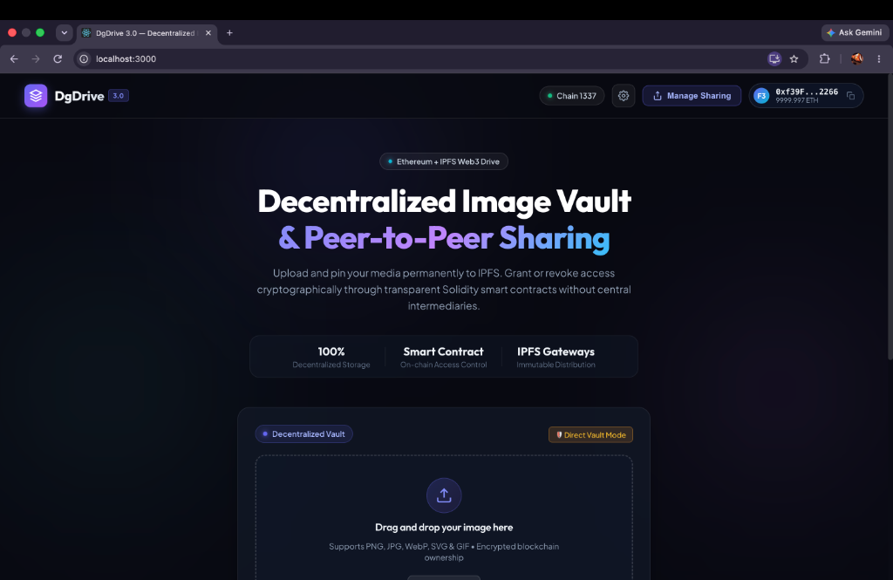
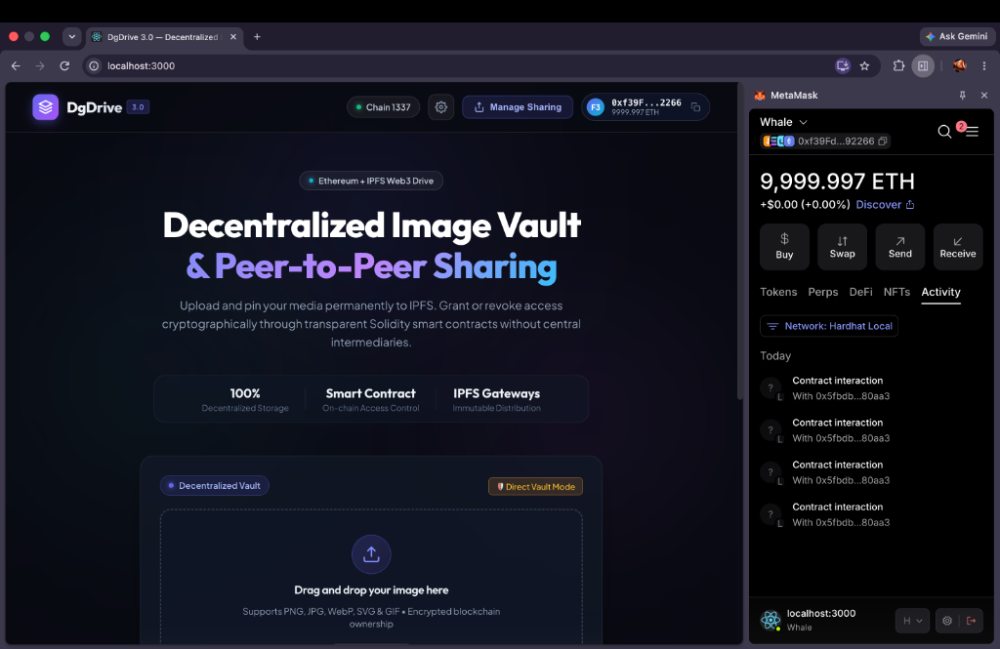
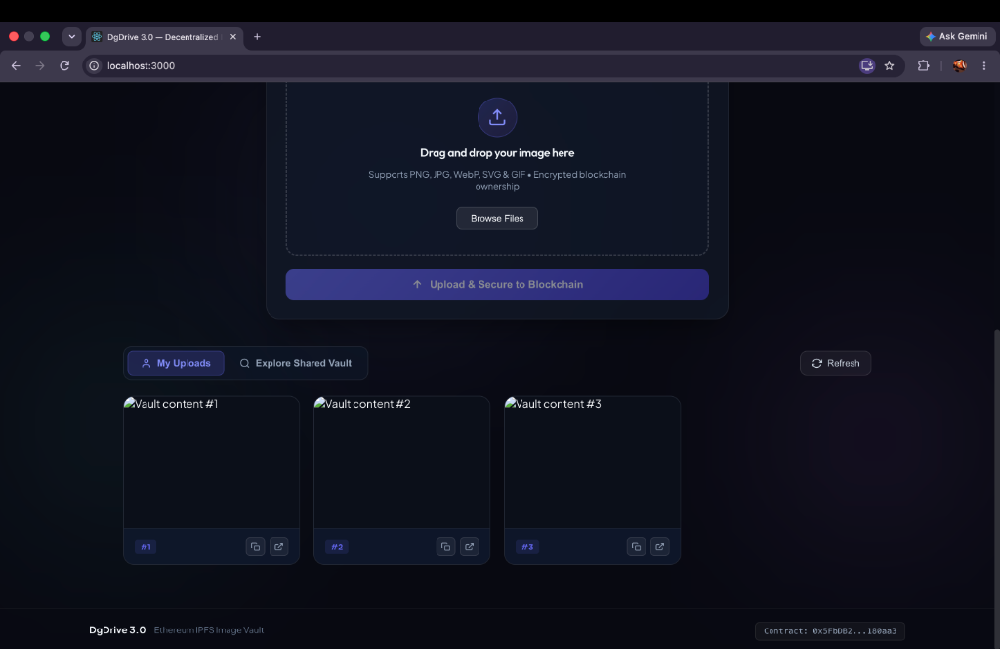
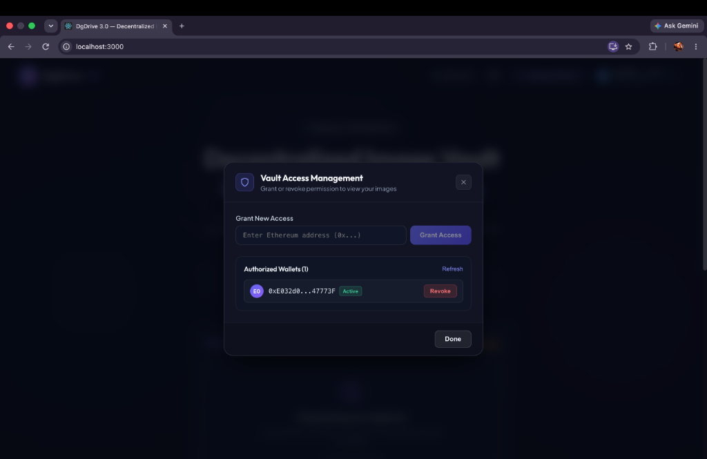
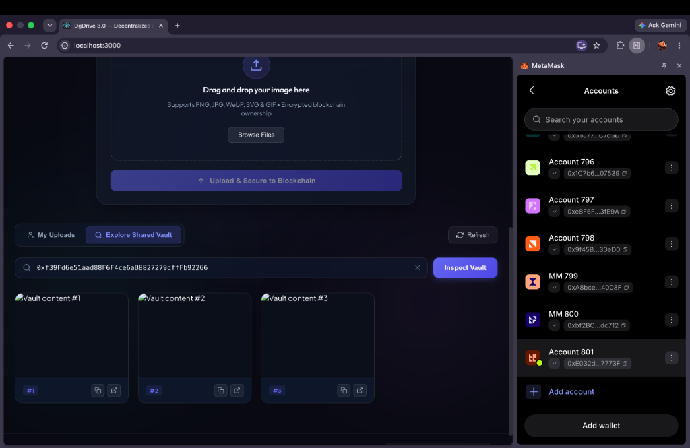

# 🌐 DgDrive 3.0 — Decentralized Image Vault & Access Sharing

[](https://soliditylang.org/)
[](https://hardhat.org/)
[](https://reactjs.org/)
[](https://ipfs.tech/)

A decentralized Web3 cloud storage and image vault built on Ethereum and IPFS. Users securely upload images to decentralized storage, record cryptographic ownership via Solidity smart contracts, and manage fine-grained peer-to-peer access control (granting and revoking permissions) directly on-chain.

---

## ✨ Features

- **Decentralized Storage:** Images are pinned to IPFS (via Pinata or multi-gateway fallbacks), ensuring tamper-proof, decentralized distribution.
- **Smart Contract Access Control:** Full on-chain permission control:
  - `add(address _user, string url)`: Records an uploaded image URI for an account.
  - `display(address _user)`: Fetches authorized files (verifies caller is owner or has been granted permission).
  - `allow(address user)`: Grants another wallet permission to view your vault.
  - `disallow(address user)`: Revokes access permissions in real time.
  - `shareAccess()`: Returns active and past authorization lists.
- **Auto Contract Configuration:** The deployment script automatically exports the deployed address to `client/src/contractAddress.json`, eliminating manual copy-pasting.
- **Dual-Mode IPFS Support:**
  - **Pinata Mode:** Connect your Pinata JWT or API Key & Secret via the in-app Settings modal or `.env`.
  - **Direct Vault Mode:** Works instantly without requiring third-party API keys or paid accounts for local development and demonstration.
- **Modern Glassmorphic UI:** Built with sleek dark aesthetic, dynamic ambient glow, interactive drag-and-drop dropzone, live image preview, lightbox viewer, and toast notifications.

---

## 📸 Application Screenshots

### 1. Main Dashboard & Hero Interface


### 2. MetaMask Connected to Local Hardhat Network (Chain 1337)


### 3. Decentralized Vault Gallery & Drag-and-Drop Uploader


### 4. On-chain Access Control & Permissions Hub (Grant & Revoke)


### 5. Peer-to-Peer Shared Vault Explorer


---

## 🛠️ Tech Stack

- **Smart Contract:** Solidity (`Upload.sol`), Hardhat, Ethers.js
- **Frontend:** React 18, Vanilla CSS (Modern Design System with Glassmorphism, CSS Tokens)
- **Decentralized Storage:** IPFS, Pinata API & Gateway, Public Gateways (`ipfs.io`, `cloudflare-ipfs.com`, `dweb.link`)

---

## 🚀 Quickstart & Setup Guide

### 1. Prerequisites

- [Node.js](https://nodejs.org/) (v16.x to v20.x recommended)
- [MetaMask](https://metamask.io/) browser extension

---

### 2. Install Dependencies

In the project root directory:
```bash
# Install root (Hardhat) dependencies
npm install

# Install client (React) dependencies
cd client
npm install
cd ..
```

---

### 3. Run Smart Contract Tests

Verify that the smart contract functions correctly:
```bash
npx hardhat test
```
*Expected: 3 passing tests covering uploads, unauthorized protection, and grant/revoke access.*

---

### 4. Start Local Blockchain & Deploy Contract

Open **Terminal 1** to start the local Hardhat node:
```bash
npx hardhat node
```
> Hardhat will start an Ethereum RPC node on `http://127.0.0.1:8545` with chain ID `1337` and provide 20 test accounts with 10,000 test ETH each. Keep this terminal running.

Open **Terminal 2** to deploy the smart contract:
```bash
npx hardhat run scripts/deploy.js --network localhost
```
> The script will deploy `Upload.sol` and automatically write the deployed address into `client/src/contractAddress.json`.

---

### 5. Launch the React Application

In **Terminal 2** (or a new terminal):
```bash
cd client
npm start
```
The application will launch in your browser at `http://localhost:3000`.

---

## 🦊 MetaMask Configuration

To interact with the local development blockchain:

1. **Add the Hardhat Local Network in MetaMask:**
   - **Network Name:** Hardhat Local
   - **New RPC URL:** `http://127.0.0.1:8545`
   - **Chain ID:** `1337` (or `31337`)
   - **Currency Symbol:** `ETH`
2. **Import a Test Account:**
   - Copy one of the private keys outputted by `npx hardhat node` in Terminal 1.
   - In MetaMask, click **Account selector -> Add account or hardware wallet -> Import account**.
   - Paste the private key. You will now have 10,000 test ETH for transactions.

---

## 📖 Application Usage Guide

### 1. Connecting Your Wallet
- Click the **Connect Wallet** button in the top navbar.
- Approve the MetaMask connection prompt.
- DgDrive will automatically detect your account address, network, and ETH balance.

### 2. Uploading Images
1. Drag and drop an image file (PNG, JPG, SVG, WebP, GIF) into the dropzone or click **Browse Files**.
2. View the instant thumbnail preview and file size.
3. Click **Upload & Secure to Blockchain**.
4. Confirm the transaction in MetaMask.
5. Once mined, the image is secured on-chain and automatically displayed in your vault gallery!

### 3. Viewing Your Images
- Click the **My Uploads** tab in the gallery section.
- Click any image card to open the high-resolution lightbox preview, copy its IPFS CID / URL, or open it in a new gateway tab.

### 4. Sharing & Managing Access Permissions
1. Click **Manage Sharing** in the navbar.
2. In the modal:
   - **Grant Access:** Paste a second Ethereum address (e.g. Account #2 from Hardhat) and click **Grant Access**. Confirm the MetaMask transaction.
   - **View Authorized Wallets:** See all addresses currently possessing access.
   - **Revoke Access:** Click **Revoke** next to any authorized address to remove their access immediately.

### 5. Accessing Another User's Vault
1. Click the **Explore Shared Vault** tab in the gallery section.
2. Enter the target user's Ethereum address.
3. Click **Inspect Vault**:
   - If that user has granted you access, their images will display immediately.
   - If that user has **not** granted you access, the app will show an **Access Restriction** warning as enforced by the smart contract!

### 6. IPFS / Pinata Configuration (Optional)
- Click the **Gear icon (⚙️)** in the navbar.
- Enter your Pinata JWT or API Key & Secret if you want to pin directly to your personal Pinata account.
- If left empty, DgDrive runs smoothly in Direct Vault Mode for seamless zero-setup testing.

---

## 🧪 Project Architecture

```
├── contracts/
│   └── Upload.sol              # Solidity smart contract for storage & access control
├── scripts/
│   └── deploy.js               # Deployment script (auto-saves address to client)
├── test/
│   └── Upload.test.js          # Unit tests verifying contract methods & reverts
├── hardhat.config.js           # Hardhat configuration (solidity 0.8.9, chainId 1337)
├── client/
│   ├── src/
│   │   ├── artifacts/          # Compiled contract ABIs
│   │   ├── components/
│   │   │   ├── FileUpload.js   # Drag-and-drop uploader with live preview & IPFS pinning
│   │   │   ├── Display.js      # Responsive gallery, tabbed vaults & lightbox
│   │   │   ├── Modal.js        # Granular access control (Grant & Revoke)
│   │   │   └── SettingsModal.js# Pinata & Contract configuration modal
│   │   ├── utils/
│   │   │   └── ipfs.js         # IPFS gateway resolution, multi-gateway fallback & pinning
│   │   ├── contractAddress.json# Auto-populated deployed contract address
│   │   ├── App.js              # Main container with Web3 wallet provider & toast system
│   │   └── index.css           # Glassmorphism tokens and design system
│   └── package.json
└── README.md
```
